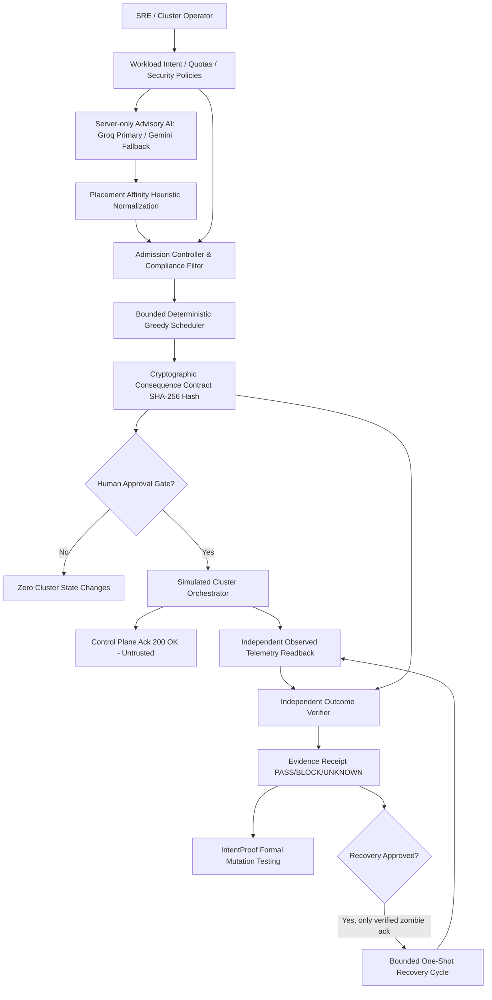

# Architecture and Boundaries: ClusterGuard

## Overview

ClusterGuard has one target user: an SRE, DevOps engineer, or cloud infrastructure operator. One mission: orchestrate credible microservice and AI workload allocations under strict node quotas and security compliance constraints, and independently verify what autonomous agentic mutations actually changed. The IntentProof engine serves as an internal verification and mutation testing harness.

## Typed Agent Flow

## Contracts

`clusterguard.contract.v1` contains scheduled workload IDs and instance counts, expected remaining cluster quotas (vCPU, GPU, RAM, NVMe, Egress, Static IPs), protected security invariants (`iam_privilege_escalation.locked`, `kernel_ebpf_sandbox.enforced`), human approval requirement, observation requirement, and a one-attempt recovery budget. Each plan includes a SHA-256 notary hash of the canonical contract. The command response and observed node state are strictly decoupled. The independent verifier checks pod allocations, quota balances, security invariants, contract hash, non-negative capacity, and unexpected state drift. Missing readback produces `UNKNOWN`, never a false `PASS`.

## Interoperability

- `LLMClient`: Calls **Groq** (`openai/gpt-oss-120b` or `llama-3.3-70b-versatile`) as the primary fast reasoning engine, and automatically falls back to **Google Gemini** (`gemini-3.8-flash`) on rate limit, downtime, or missing Groq credential. An HTTP 503 is returned if both providers fail in live mode—**no silent synthetic fallback**.
- `scheduler`: Converts placement affinity tags into **heuristic ranking** across compliant workloads; checks finite node quotas and explicit compliance policies before scheduling instances.
- `IntentProof`: Mutation audit exercises modeled contract invariants and detects unauthorized privilege side-effects (achieving 100% mutant kill rate).
- `HTTP`: Minimal same-origin JSON endpoints; server-side session token, bounded request sizes, per-IP rate-limiting, process-level live request limits, restrictive static-file routing, and strict CSP security headers.

## Assurance Limitations

Source integrity SHA-256 certifies self-consistency against the pre-declared contract; it does not establish hardware HSM provenance. In-process simulation demonstrates contract verification and guardrails without modifying physical cloud data centers.
