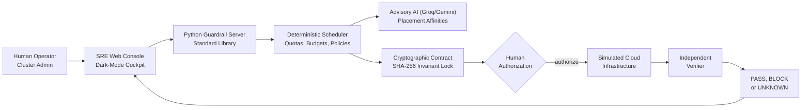
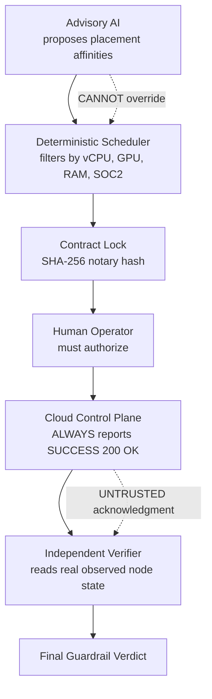
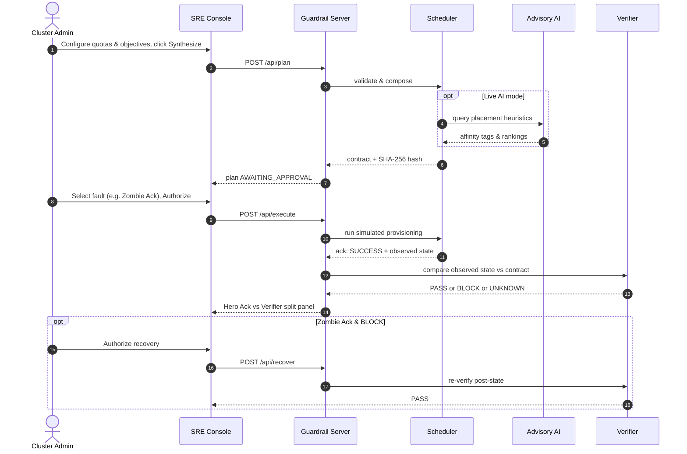

# ClusterGuard — Product & Architecture Guide

> **One-line motto:** *"Don't trust the control plane acknowledgment — verify the physical node state."*
>
> Alternative taglines: *"Autonomous cloud resource orchestration with cryptographic consequence verification."* · *"An infrastructure guardrail harness whose success status must be earned."*

---

## Table of Contents

1. [What this project actually is (in 60 seconds)](#1-what-this-project-actually-is-in-60-seconds)
2. [Why we need it](#2-why-we-need-it)
3. [Explained for non-technical people (with analogies)](#3-explained-for-non-technical-people-with-analogies)
4. [Explained for software developers & systems engineers](#4-explained-for-software-developers--systems-engineers)
5. [What it shows, screen by screen](#5-what-it-shows-screen-by-screen)
6. [How it works, step by step (with architecture diagrams)](#6-how-it-works-step-by-step-with-architecture-diagrams)
7. [How it is different](#7-how-it-is-different)
8. [How to show it to someone: a 5-minute demo script](#8-how-to-show-it-to-someone-a-5-minute-demo-script)
9. [How someone can test it themselves](#9-how-someone-can-test-it-themselves)
10. [Honest limits: what it does not do](#10-honest-limits-what-it-does-not-do)
11. [Deployment guide: Render (recommended), Docker & Cloud Run](#11-deployment-guide-render-recommended-docker--cloud-run)
12. [Quick reference](#12-quick-reference)

---

## 1. What this project actually is (in 60 seconds)

**ClusterGuard** is an enterprise-grade deterministic guardrail harness and resource orchestrator for autonomous AI infrastructure agents. It solves the critical **false success** failure mode in agentic workflows: when autonomous agents or cloud APIs report `HTTP 200 SUCCESS {"status": "Created"}` but physical node state diverges or drifts.

It accomplishes two fundamental jobs that are traditionally coupled and vulnerable:

| Job | What happens | Who does it |
|---|---|---|
| **1. Schedule & Lock** | Schedules microservices and AI workloads (vLLM, Milvus, Gateways) within strict cluster quotas (vCPU, H100 GPU, RAM, NVMe) and security compliance policies. Generates a pre-declared **cryptographic contract** hashed with SHA-256. | Deterministic Greedy Scheduler + Advisory AI (Groq/Gemini) |
| **2. Verify & Guard** | Following human sign-off, simulated execution runs. An **independent deterministic verifier** reads post-state telemetry, compares against the SHA-256 contract, and returns `PASS`, `BLOCK`, or `UNKNOWN`. | Independent Outcome Verifier |

The core lesson: **A control plane reporting "SUCCESS" is never proof that infrastructure mutations succeeded.** In ClusterGuard, command acknowledgements are explicitly untrusted. Only independent outcome verification decides success.

> All execution runs within an **isolated in-process sandbox**. No real cloud bills or physical production data centers are modified.

---

## 2. Why we need it

### The Real-World Problem in Autonomous AI & Cloud Ops
Autonomous DevOps and cloud orchestration agents report **success** when a command is *accepted*, not when the physical post-state is *correct*:

- A Kubernetes API reports pod creation, but the container is stuck in `CrashLoopBackOff` and node quotas were never reserved.
- An agent provisions a service, but silently exposes port `0.0.0.0/0` or unlocks an IAM privilege escalation flag.
- A cluster probe times out, and the agent blindly assumes success ("silent green").

### Two Needs in One Solution
1. **Deterministic Packing & Strict Trust Boundary:** AI models can suggest node placement heuristics, but can **never** waive security policies, exceed quotas, or hallucinate resources.
2. **Cryptographic Assurance:** Every mutation must be locked in a pre-declared SHA-256 contract, verified by a separate component that did not execute the command.

---

## 3. Explained for non-technical people (with analogies)

### Analogy: The Courier and the Porch

> A courier texts you: **"Package Delivered ✅"**. You walk to your porch. **There is no box.**
>
> The text was true about *the courier's button click* ("I pressed delivered"), but false about *your actual reality* ("a box is on the porch").

ClusterGuard is the inspector who checks the porch. The courier's text is the **command acknowledgement**. The physical porch check is the **independent verification**.

### The Cloud Ops Team Roles

| Role in the Datacenter | Role in ClusterGuard | What they decide |
|---|---|---|
| **Senior Solutions Architect** who suggests optimal node affinity | **Advisory AI (Groq / Gemini)** | *Where workloads run best*; advice only |
| **SRE Capacity Manager** with strict node quotas & budget caps | **Deterministic Scheduler** | *What is physically possible*; strictly overrules advice |
| **Independent Security Auditor** with a checklist & cryptographic notary | **Independent Verifier** | *Whether observed telemetry matches the signed contract* |
| **Cluster Admin** who authorizes mutations | **You (Human Operator)** | *Whether to approve execution* |

---

## 4. Explained for software developers & systems engineers

### The Architectural Pattern: Outcome Verification vs Acknowledgement

```text
orchestrate() -> contract  (pre-declared BEFORE acting, hashed with SHA-256)
approve()     -> human authorization gate (strict identity check)
execute()     -> ack + observed state  (ack is ALWAYS "SUCCESS 200 OK")
verify()      -> PASS | BLOCK | UNKNOWN  (compares observed telemetry vs contract)
recover()     -> exactly one bounded self-repair cycle, requires re-authorization
```

### Key Engineering Decisions

| Decision | Implementation | Why it matters |
|---|---|---|
| **Zero-LLM Control Loop** | Bounded greedy bin-packer (`clusterguard/agent.py`) | Deterministic, reproducible, no hallucinated cloud allocations |
| **Advisory Trust Boundary** | `fit()` scores placement affinity; admission controller filters rules *before* scoring | Advisory AI cannot waive security compliance, quotas, or budget caps |
| **Three-Valued Verdict** | `PASS` / `BLOCK` / `UNKNOWN` | If telemetry times out, returns `UNKNOWN` (never fake success) |
| **Contract SHA-256 Lock** | `sha256(canonical_json(contract))` recomputed at verify time | Instantly catches any tampering with commitments |
| **Bounded Self-Repair** | Bounded recovery strictly allowed for `false_success` + `BLOCK` | Prevents infinite retry loops |
| **IntentProof Mutation Audit** | Formal mutation testing engine (`intentproof/src/intentproof/assurance.py`) | Tests *the quality of the guardrail itself* (100% mutant kill rate) |
| **Zero-Dependency Core** | Python 3.11+ standard library only (`http.server`, `hashlib`, `json`, `uuid`) | Instant portable execution, zero CVE supply chain risk |

---

## 5. What it shows, screen by screen

| Screen / Action | What it demonstrates | The takeaway |
|---|---|---|
| **Synthesize Cluster Plan** | Quotas, budget, and compliance rules become scheduled microservices with placement reasons | Explainable packing bounded by hard invariants |
| **Cryptographic Contract** | Expected pod allocations, remaining quotas, spending cap, and immutable IAM locks | The promise is signed *before* execution |
| **Human Authorization Gate** | Nothing mutates without explicit human sign-off | Human stays in the loop |
| **Run Nominal Deployment** | Verifier returns `PASS` | The happy path matches the promise identically |
| **Run Zombie Ack** | Control plane says `SUCCESS`, verifier says `BLOCK` | **The core lesson:** Acknowledgment ≠ Outcome |
| **Run Privilege Leak** | Workload deployed, but `iam_privilege_escalation.locked` flipped to `false` -> `BLOCK` | Catches unauthorized security side effects; recovery forbidden |
| **Run Telemetry Blackout** | Readback probe times out -> `UNKNOWN` | Can't verify = honest refusal to claim success |
| **Authorize Recovery** | Bounded repair cycle re-verifies post-state to `PASS` | Fixes are verified too, never trusted |
| **AI vs Baseline** | Ablation with and without advisory AI | Shows advisory AI impact in isolation |
| **50% Quota Shock** | Tests plan elasticity under supply contraction | Demonstrates resilience without modifying active state |
| **IntentProof Mutation Audit** | Deliberately corrupts promises one by one (100% caught) | Proves the guardrail harness itself works |
| **Cryptographic Evidence** | SHA-256 notary receipt verification and JSON export | Tamper-evident audit trail |

---

## 6. How it works, step by step (with architecture diagrams)

### 6.1 The Big Picture



### 6.2 The Trust Boundary



### 6.3 Sequence Flow



---

## 7. How it is different

| Traditional System | What it usually does | What ClusterGuard adds |
|---|---|---|
| **Cloud Auto-Scalers** | Scale pods on raw threshold metrics | Pre-declares post-state contract; verifies outcome before committing |
| **Agentic DevOps Bots** | Report "Done!" with confident prose | The "done" is explicitly untrusted; independent verifier decides |
| **Policy Engines (OPA/Kyverno)** | Validate requests at admission time | Validates post-execution state against signed contract |
| **Standard Unit Tests** | Test whether code passes tests | **IntentProof Mutation Audit** tests whether the guardrail catches all corruptions |

---

## 8. How to show it to someone: a 5-minute demo script

| Time | You do | You say |
|---|---|---|
| 0:00 | Open SRE Cockpit | "This is ClusterGuard. It orchestrates cloud microservices and solves the false-success problem in autonomous AI agents." |
| 0:30 | Select Deep Learning Core, click **Synthesize** | "Our deterministic scheduler packs workloads into node quotas, guided by advisory AI. Notice: 12 instances planned within budget." |
| 1:15 | Show the **Cryptographic Contract** tab | "Before anything mutates, it signs a pre-declared contract hashed with SHA-256: exact pod allocations, remaining quotas, and immutable IAM locks." |
| 1:45 | Select **Nominal Deployment** → Authorize | "Under nominal conditions, the independent verifier inspects observed node state and confirms **PASS**." |
| 2:30 | Synthesize again, select **Zombie Ack (False Success)** → Authorize | "Now I inject a silent failure. Look at the Hero panel: the control plane claims SUCCESS 200 OK... but our independent verifier says **BLOCK**! Pods were never created." |
| 3:15 | Point at the pulsating disagreement alarm and diff table | "This is the core idea: API acks are untrusted. Only verified reality counts." |
| 3:30 | Authorize **Safe Recovery** | "A secondary human authorization allows one bounded repair cycle. Post-state is re-inspected to **PASS**." |
| 4:00 | Click **AI vs Baseline** | "Ablation test: same deterministic rules, with and without advisory AI. Isolates placement heuristics." |
| 4:30 | Click **Mutation Audit** | "We deliberately corrupted 6 contract invariants. IntentProof caught all 6 (100% mutant kill rate)." |
| 5:00 | Close with the motto | "Don't trust the control plane acknowledgment. Verify the physical node state." |

---

## 9. How someone can test it themselves

### As an Operator (No Coding)
1. Open `http://127.0.0.1:8765` and click **Synthesize Verified Cluster Plan**.
2. Tick **Deny Public Ingress**, click Synthesize, and confirm the API Gateway workload is rejected by the admission controller.
3. Test all 4 fault scenarios: **Nominal (`PASS`), Zombie Ack (`BLOCK`), Privilege Leak (`BLOCK`), Telemetry Blackout (`UNKNOWN`)**.
4. Test one-shot recovery on Zombie Ack to verify state repair.
5. In the Formal Proof tab, run **Mutation Audit** and observe the 100% mutant kill rate.
6. Export the cryptographic evidence JSON receipt and inspect its SHA-256 self-hash.

### As a Developer
```bash
# Start ClusterGuard server
python -m clusterguard.server

# Run ClusterGuard and Agent unit test suites (32 tests)
python -m unittest tests/test_clusterguard.py -v

# Run IntentProof mutation assurance tests (33 tests)
PYTHONPATH=intentproof/src python -m unittest discover -s intentproof/tests -v

# Health check endpoint
curl http://127.0.0.1:8765/healthz
# {"status":"ok","service":"ClusterGuard","simulation":true}
```

---

## 10. Honest limits: what it does not do

| Limit | Detail |
|---|---|
| **Simulation sandbox** | All cluster mutations run in-process; no actual cloud infrastructure or billing is modified |
| **No generative AI in scheduler** | The scheduler is pure deterministic greedy packing; the LLM provides advisory placement affinity only |
| **Single-process sessions** | Session state is maintained in-process with a 1-hour TTL |
| **Receipt hash ≠ hardware HSM signature** | SHA-256 self-consistency hash certifies contract adherence; not a hardware cryptographic signature |

---

## 11. Deployment guide: Render (recommended), Docker & Cloud Run

ClusterGuard is designed for zero-downtime, zero-dependency deployment on any platform:

### Render Deployment (Recommended)
1. Connect repository to Render.
2. Select **New → Blueprint** and select `render.yaml`.
3. In Render dashboard:
   - `LLM_LIVE_ENABLED: "1"`
   - `MAX_LIVE_PLANS: "50"`
   - Add `GROQ_API_KEY` or `GEMINI_API_KEY` under Environment Variables.
4. Health check path: `/healthz`.

### Docker
```bash
docker build -t clusterguard .
docker run -p 8765:8765 clusterguard
```

---

## 12. Quick reference

| Item | Specification |
|---|---|
| **Motto** | Don't trust the control plane acknowledgment — verify the physical node state. |
| **Core Problem** | Silent state drift & false acknowledgements in autonomous infrastructure agents |
| **Verdicts** | `PASS` (contract verified) · `BLOCK` (divergence detected) · `UNKNOWN` (telemetry blackout) |
| **Fault Scenarios** | Nominal · Zombie Ack · Privilege Leak · Telemetry Blackout |
| **Scheduler** | Pure deterministic greedy bin-packer (Zero LLM in the control loop) |
| **Advisory AI** | Groq (Llama 3.3 / GPT-OSS) primary + Gemini fallback (placement heuristics only) |
| **Contract** | SHA-256 hashed JSON pre-condition lock |
| **Test Coverage** | 32 app tests + 33 IntentProof mutation tests (all passing) |
